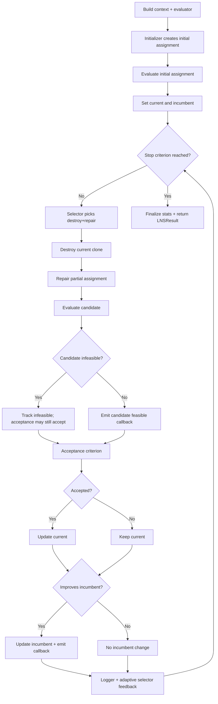

# Unifying Search Framework

The `wp5/source/unifying_framework` package implements a unifying optimization workflow over shared
**OptDSL** problem descriptions. A single `.dsl` model can be dispatched to two conceptually different
backends:

- **Heuristic backend — Large Neighborhood Search (LNS):** [`run_lns.py`](run_lns.py) +
  the `large_neighborhood_search/` package. Operates directly on the DSL decision variables using
  destroy/repair neighborhoods and problem-specific operators.
- **Exact backend — MiniZinc:** [`run_minizinc.py`](run_minizinc.py) + the pinned OptDSL translator
  under `src/optdsl/`. Translates the DSL to MiniZinc and dispatches to the solver portfolio
  (`gecode`, `cp-sat`, `chuffed`, …).

Because both backends consume identical problem descriptions, users can defer the paradigm decision,
switch paradigms as requirements evolve, and compare both under a common protocol without re-modeling.
An LNS solution can also be written back as a DSL `@warm_start` snapshot and re-injected into the exact
backend for validation or bound improvement (see [Warm-Start Workflow](#warm-start-workflow)).

---

# Part I — User Guide

## 1. Installation & Environment

**Prerequisites:** Python 3.11, MiniZinc 2.10.x with solvers (`gecode`, `cp-sat`, `chuffed`), and
[`uv`](https://docs.astral.sh/uv/).

```powershell
# from the framework root (where pyproject.toml sits)
uv sync
```

Run any command below with `uv run python …` (or the project venv directly:
`.\.venv\Scripts\python.exe …`). The project venv is pinned to `~=3.11.0`; the MinZinc Python bindings
(`minizinc`) and solver bridge are project dependencies.

**Smoke tests** (validate both backends end-to-end on the smallest instance of each problem family):

```powershell
# run_minizinc.py + run_lns.py per problem family
powershell -ExecutionPolicy Bypass -File .\test\test_all.ps1

# LNS → warm-start DSL → run_minizinc.py loop
powershell -ExecutionPolicy Bypass -File .\test\test_warm_starts.ps1
```

## 2. Running the LNS Backend

```powershell
uv run python run_lns.py <file.dsl> [options]
```

The CLI entry point [`run_lns.py`](run_lns.py) composes the LNS engine, an initializer, the
neighborhood pool (destroy/repair combinations), acceptance policy, stop criteria, and output hooks.

### Common options

| Flag | Effect | Default |
|---|---|---|
| `--initializer` | `random`, `greedy`, `mcmc`, `cvrp`, `jssp`, `2dbp`, `cutting_packing`, `woodcutting_pipeline` | `greedy` |
| `--operator-profile` | `generic` or `permutation` — see [Operator Profiles](#4-operator-profiles) | `generic` |
| `--max-iterations` | LNS iteration budget | `10000` |
| `--max-runtime-seconds` | Optional wall-clock cap | none |
| `--no-improvement-iterations` | Optional convergence stop | none |
| `--random-seed` | Seeded RNG for reproducible runs | `42` |
| `--lns-run-restarts` / `--lns-run-seed-step` | Independent full runs with incremented seeds; best reported | 1 / 1 |
| `--acceptance` | `improving` or `sa` (simulated annealing) | `improving` |
| `--lns-adaptive-selection` | Enable ALNS roulette-wheel selector with adaptive destroy intensity | off |
| `--lns-destroy` / `--lns-repair` | Explicit operator names to build neighborhoods (see operator reference) | per-family defaults |
| `--lns-destroy-fraction` | Fraction destroyed per iteration | `0.25` |
| `--lns-init-restarts` | Restart attempts for constructive initializers | family default |
| `--init-restarts` / `--init-scoring` | Greedy initializer restarts and `objective`/`feasibility-first` scoring | 1 / `objective` |
| `--print-assignment` | Print the incumbent assignment | off |
| `--emit-feasible-dsl` | Write feasible DSL snapshots (`@warm_start`) with `{iteration}`, `{event}`, `{score}` placeholders | none |
| `--export-assignment-json` | Export the incumbent assignment as JSON (downstream tools) | none |

### Quick start per problem family

**1D Bin Packing**

```powershell
uv run python run_lns.py .\problem_instances\1dbp\problem_2_t_zero_based.dsl --max-iterations 500 --log-every 100
```

**2D Bin Packing** (feasibility-focused greedy recommended)

```powershell
uv run python run_lns.py .\problem_instances\2dbp\random_2dbp_zero_based.dsl --init-scoring feasibility-first --init-restarts 32 --max-iterations 500 --log-every 10
```

**CVRP** (arc encoding)

```powershell
uv run python run_lns.py .\problem_instances\cvrp\random_euclidean_cvrp_8.dsl --initializer cvrp --max-iterations 200 --log-every 50
```

**Job Shop Scheduling (JSSP)**

```powershell
uv run python run_lns.py .\problem_instances\jssp\jssp_2x2.dsl --initializer jssp --max-iterations 1000
uv run python run_lns.py .\problem_instances\jssp\jssp_5x4.dsl --initializer jssp --lns-destroy-fraction 0.25 --max-iterations 2000
uv run python run_lns.py .\problem_instances\jssp\jssp_10x5.dsl --initializer jssp --lns-init-restarts 16 --max-iterations 3000
```

**Woodcutting** (rich pipeline model)

```powershell
uv run python run_lns.py .\problem_instances\woodcutting\benchmarks\generated_noreorder\one_beam_no_faults.dsl --initializer woodcutting_pipeline --max-iterations 6000
```

> **Note on file formats:** the LNS frontend expects **OptDSL `.dsl` models**. Raw benchmark JSON
> (e.g. `problem_instances\woodcutting\benchmarks\*.json`) is converted to `.dsl` first by the
> `Tools/convert_*` scripts. Pointing `run_lns.py` at a `.json` gives an empty model
> (`Decision indices: 0`).

## 3. Operator Profiles

`--operator-profile` selects the neighbourhood/operator toolset:

- **`generic`** (default) — standard destroy/repair; used for bin packing, CVRP arc encoding, JSSP,
  cutting-packing, and woodcutting.
- **`permutation`** — permutation-preserving initializer/repair/destroy for giant-tour encodings where
  a route is a city permutation (e.g. `city_tour` in `cvrp_20_gt.dsl`).

```powershell
# generic profile — CVRP arc encoding
uv run python run_lns.py .\problem_instances\cvrp\random_euclidean_cvrp_8.dsl --operator-profile generic --initializer cvrp --max-iterations 200 --log-every 50

# permutation profile — giant tour
uv run python run_lns.py .\problem_instances\cvrp\random_euclidean_cvrp_20_gt.dsl --operator-profile permutation --initializer greedy --max-iterations 200 --log-every 50
```

In permutation mode the run uses a permutation-preserving initializer, a permutation-segment destroy,
and a repair that fills missing permutation values without duplicates.

> The `--operator-profile` selects *generic vs permutation* tooling only. Problem-specific operators
> (CVRP/JSSP/2DBP/woodcutting) are activated by `--initializer <family>` or by naming operators
> explicitly via `--lns-destroy` / `--lns-repair`.

## 4. Initialization Strategies

```powershell
# Default greedy (randomized)
--initializer greedy --init-restarts 1 --init-scoring objective

# Feasibility-focused greedy (recommended for 2DBP)
--initializer greedy --init-restarts 32 --init-scoring feasibility-first

# CVRP-specific constructive initializer
--initializer cvrp --cvrp-init-restarts 16 --cvrp-init-randomization 0.3

# JSSP-specific constructive initializer (SPT dispatch)
--initializer jssp --lns-init-restarts 16 --lns-destroy-fraction 0.25

# Random assignment
--initializer random
```

## 5. Problem-Specific Operators (reference)

All operators live in `large_neighborhood_search/problems/` and are re-exported from the package root
(`from large_neighborhood_search import ...`). Detection helpers (`detect_<family>_problem`) let the
framework opt in per model.

> **Operator provenance.** The problem-specific construction, destroy, and repair operators in this
> framework were generated **interactively with an LLM** — an LLM-assisted authoring loop in which a
> model proposes candidate operators that are then validated and refined until they work. They are
> therefore *examples of LLM-generated operators*, produced semi-interactively for each problem family
> (CVRP, JSSP, 2D bin packing, cutting & packing, woodcutting) rather than through a fully automated
> pipeline.
>
> The **automation** of exactly this step is provided by
> [`wp6/hybrid_solver`](../wp6/hybrid_solver/): the **operator-synthesis** harness
> (`operator-synthesis/operator_synthesis/`) runs an autonomous *propose → validate → feed back →
> retry* loop and persists accepted operators as self-contained modules that the LNS CLI can load via
> the operator registry; the **`optdsl_agent`** TUI wraps the same loop (plus /solve, /lns, /tune) in an
> interactive assistant. See [`wp6/hybrid_solver/docs/tooling.md`](../wp6/hybrid_solver/docs/tooling.md)
> and [`wp6/hybrid_solver/optdsl_agent/README.md`](../wp6/hybrid_solver/optdsl_agent/README.md).
> The operators shipped here in `wp5` document the manual/LLM-assisted seed set; the wp6 tooling can
> regenerate and extend them automatically.

### 5.1 CVRP

Files: `problems/cvrp.py`, `problems/cvrp_operators.py`.

| Component | Class | Behavior |
|---|---|---|
| Initializer | `CVRPRouteInitializer` | Randomized nearest-neighbor route construction, capacity-feasible |
| Destroy | `CVRPRouteBreakDestroy` | Remove whole routes (`random` / `worst` / `largest`) |
| Destroy | `CVRPWCUSTOMERDestroy` | Remove worst/random customers (worst = high insertion cost) |
| Destroy | `CVRPShawDestroy` | Relatedness-based removal (distance + demand), optional noise |
| Destroy | `CVRPClusterDestroy` | Angular-window (sweep) removal around a random centre |
| Destroy | `CVRPSegmentDestroy` | Remove a contiguous chain from one route |
| Repair | `CVRPInsertionRepair` | Cheapest insertion |
| Repair | `CVRPRegretInsertionRepair` | Regret-k insertion |
| Repair | `CVRPOROptRepair` | OR-opt relocation |
| Repair | `CVRPTwoOptRepair` | 2-opt intra-route |
| Repair | `CVRPInterRouteRepair` | Inter-route moves |
| Hook | `prepare_cvrp_assignment_for_evaluation` | Recompute `vehicle_used`/`u` from the `arcs` assignment |

### 5.2 Job Shop Scheduling (JSSP)

Files: `problems/jssp.py`, `problems/jssp_optdsl.py`. Operators target the two defining constraint
families: job precedence and machine no-overlap.

| Component | Class | Behavior |
|---|---|---|
| Initializer | `JSSPScheduleInitializer` | SPT dispatch; restarts keep best makespan |
| Destroy | `JSSPJobLevelDestroy` | Zero all operations of a fraction of jobs |
| Destroy | `JSSPMachineLevelDestroy` | Zero all operations on a fraction of machines |
| Destroy | `JSSPShuffleDestroy` | Shuffle a random segment within each selected job |
| Destroy | `JSSPSwapDestroy` | Swap random operation blocks between two jobs |
| Destroy | `JSSPShiftTimesDestroy` | Offset selected jobs' operation times |
| Destroy | `JSSPCriticalPathDestroy` | Clear critical-path operations (`critical` / `neighbor`) |
| Destroy | `JSSPCriticalBlockDestroy` | Clear a contiguous block on the bottleneck machine |
| Destroy | `JSSPGapDestroy` | Clear operations bordering the tightest machine gaps |
| Destroy | `JSSPTimeWindowDestroy` | Clear around the current bottleneck time window |
| Destroy | `JSSPBottleneckMachineDestroy` | Clear operations on the most loaded machines |
| Repair | `JSSPGanttRepair` | Full SPT re-schedule from scratch |
| Repair | `JSSPConstraintAwareRepair` | Anchor non-destroyed ops, extend forward |
| Repair | `JSSPInsertionRepair` | Priority active-schedule insertion |
| Repair | `JSSPNonDelayRepair` | Non-delay construction |
| Repair | `JSSPOptActiveScheduleRepair` | Look-ahead cheapest insertion + back-shift passes |
| Repair | `JSSPRemainingWorkRepair` | Dispatch preferring most remaining work |
| Repair | `JSSPMachineBalanceRepair` | Balance machine load during repair |
| Repair | `JSSPCriticalBlockReinsertRepair` | Reinsert one op inside the critical block |

**Objective:** minimize makespan (completion of the last operation).

### 5.3 2D Bin Packing

File: `problems/binpacking_2d.py`.

| Component | Class | Behavior |
|---|---|---|
| Destroy | `DBPClearBoxesDestroy` | Clear whole boxes (`random` / `largest_load`) |
| Destroy | `DBPClearItemsDestroy` | Clear a fraction of items |
| Repair | `DBPGreedyPlacementRepair` | Greedy placement with restarts |
| Repair | `DBPFullRepackRepair` | Full repack with restarts |

### 5.4 Cutting & Packing (1D cutting stock + layer bin packing)

File: `problems/cutting_packing.py`.

| Component | Class | Behavior |
|---|---|---|
| Initializer | `CuttingPackingInitializer` | Constructive layer/cut assembly |
| Destroy | `CuttingPackingLayerDestroy` | Remove whole layers (`random` / `fullest`) |
| Destroy | `CuttingPackingPieceDestroy` | Remove a fraction of pieces |
| Repair | `CuttingPackingRepackRepair` | Repack with restarts |
| Repair | `CuttingPackingInsertionRepair` | Greedy insertion |
| Repair | `CuttingPackingRecutRepair` | Re-cut a layer with restarts |

### 5.5 Woodcutting Pipeline

File: `problems/woodcutting_pipeline.py`. Operates on the rich pipeline DSL model
(`Board`/`Interval`/`Piece`/`CutList` DSRecords) and handles both the no-reorder and board-reorder
variants. Piece reordering is interpreted as a single-hold `pout/pin` exchange matching the WoodCutter
simulator's buffer semantics.

| Component | Class | Behavior |
|---|---|---|
| Initializer | `WoodcuttingPipelineInitializer` | Constructive board/cut/keep plan with beam-skip margins |
| Destroy | `WoodcuttingCutDestroy` | Remove board cuts |
| Repair | `WoodcuttingCutRepair` | Regenerate cut positions |
| Destroy | `WoodcuttingKeepDestroy` | Drop a fraction of kept pieces |
| Repair | `WoodcuttingKeepRepair` | Re-select kept pieces (strict exact-fill for strict models) |
| Destroy | `WoodcuttingSwapDestroy` | Swap board/piece reorder decisions |
| Repair | `WoodcuttingSwapRepair` | Rebuild reorder with samples |
| Destroy | `WoodcuttingCarryThreadDestroy` | Clear a carried beam thread |
| Repair | `WoodcuttingCarryThreadRepair` | Rebuild the carried thread |

## 6. Running the MiniZinc (Exact) Backend

```powershell
uv run python run_minizinc.py <file.dsl> --timelimit 120 --solver cp-sat
```

Options:

- `--timelimit <s>` — solver time budget (solve only; translation runs before it).
- `--solver <name>` — `gecode` (default), `cp-sat`, `chuffed`, …
- `--dump-mzn [out.mzn]` — translate to MiniZinc only (do not solve).
- `--dsl-index-base 0|1` — Python-style (0) vs legacy (1) indexing.
- `--minizinc-path <bin>` — override the MiniZinc executable.
- `--progress` — periodic progress output.

Output is JSON with `objective`, `objective_bound`, `status`, and statistics. CP-SAT is a heuristic
optimum-prover: on instances not proved within the budget the objective can vary slightly between runs
(this is solver variance, not a framework defect); the DSL→MiniZinc translation itself is deterministic.

## 7. Benchmark & Study Harness

Directory: `studies/optdsl_bench/`. Compares MiniZinc vs LNS on shared instances and merges results
into a single table.

```powershell
# Run the full size study (MiniZinc + LNS) over calibrated Small/Medium sets
uv run python studies\optdsl_bench\benchmarks\run_study.py --solver cp-sat --timeout 120 --out output\study_results

# Per-class benchmark on a directory of instances
uv run python studies\optdsl_bench\benchmarks\benchmark_jssp.py --files problem_instances\jssp\jssp_2x2.dsl
```

- Per-class harness: `benchmarks/benchmark_{cvrp,jssp,2dbp,woodcutting,cvrptw}.py` (share
  `_comparison_common.py`). CVRPTW requires an instance set not yet in the repository layout.
- Profile runners: `runners/run_{cvrp,jssp,2dbp,woodcutting}_lns.py` encapsulate per-problem operator
  defaults (`_profile_common.py`); `--dry-run` prints the resolved command.
- Calibrated budgets per instance set are in `benchmarks/instance_sets.json` and account for the
  DSL→MiniZinc **translation** cost (which dominates for large models).

### Warm-Start Workflow

The benchmark can save each run's best LNS solution as a DSL `@warm_start` snapshot and optionally run
MiniZinc on it for a 3-way comparison (MiniZinc vs LNS vs MiniZinc-with-warmstart):

```powershell
uv run python studies\optdsl_bench\benchmarks\benchmark_2dbp.py --save-warmstart
uv run python studies\optdsl_bench\benchmarks\benchmark_2dbp.py --mz-warmstart
```

The MiniZinc translator parses `@warm_start` decorators and emits MiniZinc `warm_start(...)` solve
annotations plus objective-bound constraints, closing the heuristic → exact loop within one workflow.

## 8. Visualization, Converters & Simulation

### Visualization (`Tools/`)

```powershell
# CVRP route map (arcs encoding)
uv run python .\Tools\visualize_cvrp_solution.py --dsl-file .\problem_instances\cvrp\random_euclidean_cvrp_8.dsl --result-file <solver_output.txt> --output cvrp_viz.html
# CVRP giant-tour encoding
uv run python .\Tools\visualize_cvrp_solution.py --dsl-file .\problem_instances\cvrp\random_euclidean_cvrp_20_gt.dsl --encoding giant-tour --output cvrp_gt_viz.html

# JSSP Gantt chart (expects a @warm_start DSL snapshot)
uv run python .\Tools\visualize_jssp_solution.py --dsl-file .\problem_instances\jssp\lns_jssp_snapshot.dsl --output jssp_viz.html
```

### Converters / generators (`Tools/`)

Raw benchmark formats → OptDSL `.dsl`: `convert_2dbp_to_optdsl.py`,
`convert_golden_cvrp_to_optdsl.py`, `convert_golden_cvrp_to_optdsl_giant_tour.py`,
`convert_woodcutting_benchmarks_noreorder.py`, `convert_cutting_packing.py`. Plus generators:
`generate_2dbp_instances.py`, `generate_woodcutting_dsl_variants.py`. The `converters/` package also
holds CVRP/CVRPTW/JSSP converters used by the root test-suite.

### Woodcutting simulator commands

The framework can emit the raw command stream the WoodCutter Java simulator consumes. From an LNS
solution:

```powershell
uv run python run_lns.py .\problem_instances\woodcutting\benchmarks\generated_noreorder\one_beam_no_faults.dsl --initializer woodcutting_pipeline --export-assignment-json assignment.json
uv run python .\Tools\woodcutting\export_lns_solution.py .\problem_instances\woodcutting\benchmarks\generated_noreorder\one_beam_no_faults.dsl assignment.json -o lns_processed_solution.json --commands-output commands.txt --emit-instance-json instance.json
```

(`process_instance.py` computes the reference command plan directly from a raw instance JSON; requires
`wp2/source/problem-data-generator` on `PYTHONPATH`.)

---

# Part II — Architecture

## 9. High-Level Overview

The LNS backend is a compositional framework:

- Engine orchestrates iterative destroy-repair search.
- Components define pluggable strategy interfaces.
- Models provide shared runtime state and results.
- Defaults provide standard destroy/repair/acceptance/stop/logger implementations.
- A problem-adaptation layer maps OptDSL decision indices and constraints into an LNS context and
  evaluator.
- Optional problem-specific adapters (CVRP/JSSP/2DBP/cutting-packing/woodcutting) layer stronger
  structure-aware behavior on top.

Core package entry: `large_neighborhood_search/__init__.py`.

## 10. LNS Core Modules

### 10.1 Engine — `large_neighborhood_search/engine.py`

Class `LargeNeighborhoodSearchEngine`; key method `run(context: LNSContext) -> LNSResult`.

- Builds the initial assignment via the configured initializer and evaluates it.
- Selects a `(destroy, repair)` neighborhood each iteration.
- Applies acceptance and stop criteria.
- Tracks incumbent and statistics (iterations, accepted, improvements, infeasible candidates, elapsed).
- Honors optional `max_runtime_seconds` and `no_improvement_iterations` stops.
- Emits feasible-solution callback events (`initial`, `candidate_feasible`, `accepted_feasible`,
  `incumbent_update`) and feeds adaptive selectors via `record_result`.

### 10.2 Contracts — `large_neighborhood_search/components.py`

Abstract interfaces: `DestroyOperator`, `RepairOperator`, `NeighborhoodSelector`,
`AcceptanceCriterion`, `StopCriterion`, `Evaluator`, `FeasibilityClassifier`, `Initializer`,
`LNSLogger`. These decouple orchestration from specific heuristics.

### 10.3 Runtime Data Model — `large_neighborhood_search/models.py`

- `LNSContext` — constants, objective sense, dynamic `extra` runtime data (RNG, decision metadata,
  problem data, pre-evaluation hooks).
- `LNSStats`, `LNSSolution`, `LNSState`, `LNSResult`.

### 10.4 Defaults — `large_neighborhood_search/defaults.py`

- Destroy: `RandomFractionDestroy`, `VariableBlockDestroy`, `PermutationSegmentDestroy`.
- Repair: `RandomRepair`, `FillMissingPermutationRepair`, `SampledRepair`.
- Initializers: `PermutationPreservingInitializer` (plus `GreedyRandomizedInitializer`,
  `MCMCInitializer`, `RandomAssignmentInitializer` exported from `lns.py`).
- Selection: `NeighborhoodPoolSelector` (uniform), `AdaptiveNeighborhoodSelector` (ALNS
  roulette-wheel weights + adaptive destroy intensity).
- Acceptance: `ImprovingAcceptance`, `SimulatedAnnealingAcceptance`.
- Stop: `MaxIterationsStop`.
- Logging: `StdoutLNSLogger`.
- Feasibility: `PenaltyBasedFeasibilityClassifier`, `OptDSLFeasibilityClassifier`.
- Permutation helpers: `_permutation_specs`, `has_permutation_decisions`.

### 10.5 Problem Reading & Context — `large_neighborhood_search/lns.py`, `problem_reader.py`

- `read_problem_for_lns`, `read_problem`, `read_problem_from_code` parse the OptDSL module into
  constants, variables, constraints, decision indices, and objective (`importer.py`).
- Builds `decision_keys`, `decision_domains`, `keys_by_variable`, binary sparsity heuristics; excludes
  the objective variable and any excluded variables.
- Supports `DSInt` scalar and `DSList`/record-collection decisions, including record-valued variables
  in pipeline models (woodcutting).

### 10.6 Evaluation — `large_neighborhood_search/lns.py`

`OptDSLEvaluator`: uses parsed runtime constraint functions (`_expr_eval.py` for pipeline models),
counts failed assertions as violations, produces penalty scores for infeasible candidates, supports
`evaluate_detailed` for greedy/feasibility-first search, and rejects unassigned/negative decisions.

## 11. Iteration Control Flow



## 12. MiniZinc Backend Internals

- `src/optdsl/` is a pinned copy of the OptDSL translator/solver (`src/optdsl/solver/DSL_solver.py`,
  `src/optdsl/translator/Objects/MiniZincTranslator.py`, and the translator object graph). Package
  re-exports (`src/__init__.py`): `DSLSolver`, `MiniZincTranslator`.
- `run_minizinc.py` loads a `.dsl`, uses `DSLSolver` to translate and solve, and prints JSON.
- The translator consumes `@warm_start` annotations (LNS snapshots) to seed/guide the exact solve.

> This copy mirrors `wp2/source/minizinc/src/optdsl/`; keep the two in sync when changing the
> translator.

## 13. How Configuration Enters the System

Assembled in `run_lns.py` (see [Usage](#2-running-the-lns-backend)):

- Initializer selection (`--initializer`), operator profile (`--operator-profile`), explicit
  operator pools (`--lns-destroy` / `--lns-repair`) built in **sorted** order so pool ordering is
  independent of `PYTHONHASHSEED` (reproducibility).
- Adaptive selection (`--lns-adaptive-selection`), acceptance (`--acceptance`), stop criteria
  (`--max-iterations`, `--max-runtime-seconds`, `--no-improvement-iterations`), restarts and seeding.
- Output hooks: `--emit-feasible-dsl`, `--export-assignment-json`, `--print-assignment`.

## 14. Extension Points

To add a new strategy, implement the relevant interface in `components.py` and inject it through engine
composition:

- Destroy: subclass `DestroyOperator`, implement `destroy(assignment, context)`.
- Repair: subclass `RepairOperator`, implement `repair(partial_assignment, context)`.
- Acceptance / Stop: subclass `AcceptanceCriterion` / `StopCriterion`.
- Problem initializer: subclass `Initializer`, optionally add a detection helper and pre-evaluation
  hook.

To add a new problem family end-to-end:

1. Add `large_neighborhood_search/problems/<family>.py`.
2. Export operators + `detect_<family>_problem` from `large_neighborhood_search/__init__.py`.
3. Register in `run_lns.py`: `--initializer` value, default destroy/repair pool (sorted order),
   operator-profile fallback.
4. Add a profile runner under `studies/optdsl_bench/runners/` and optionally a
   `benchmarks/benchmark_<family>.py`.
5. Add converters/generators under `Tools/` if new raw formats must become `.dsl`.

## 15. Reproducibility Notes

- With a fixed `--random-seed`, LNS results are deterministic within a process; operator-pool ordering
  is kept hash-independent by sorting the operator-name sets in `run_lns.py`.
- MiniZinc runs are capped by `--timelimit` plus a translation allowance; CP-SAT on unproved instances
  can vary slightly (solver variance, not a framework defect). Translation is deterministic.
- Pinned environments (`uv.lock`/`poetry.lock`, MiniZinc 2.10.x, Python 3.11) and explicit seeds/time
  budgets in the study READMEs support reproduction.

## 16. File Reference Index

- Engine loop: `large_neighborhood_search/engine.py`
- Contracts: `large_neighborhood_search/components.py`
- Runtime state model: `large_neighborhood_search/models.py`
- Default operators/policies: `large_neighborhood_search/defaults.py`
- Context build + evaluator + generic initializers: `large_neighborhood_search/lns.py`
- OptDSL import/parse: `large_neighborhood_search/importer.py`, `large_neighborhood_search/problem_reader.py`
- DSL expression evaluation (pipeline models): `large_neighborhood_search/_expr_eval.py`
- Shared utilities: `large_neighborhood_search/_utils.py`
- Problem adapters: `large_neighborhood_search/problems/{cvrp,cvrp_operators,jssp,jssp_optdsl,binpacking_2d,cutting_packing,woodcutting_pipeline}.py`
- Package exports: `large_neighborhood_search/__init__.py`
- LNS CLI entry point: `run_lns.py`
- MiniZinc exact backend: `run_minizinc.py`, `src/optdsl/`
- Study/benchmark harness: `studies/optdsl_bench/benchmarks/`, `studies/optdsl_bench/runners/`
- Converters/generators/visualizers/simulator-export: `Tools/`
- Smoke tests: `test/`
